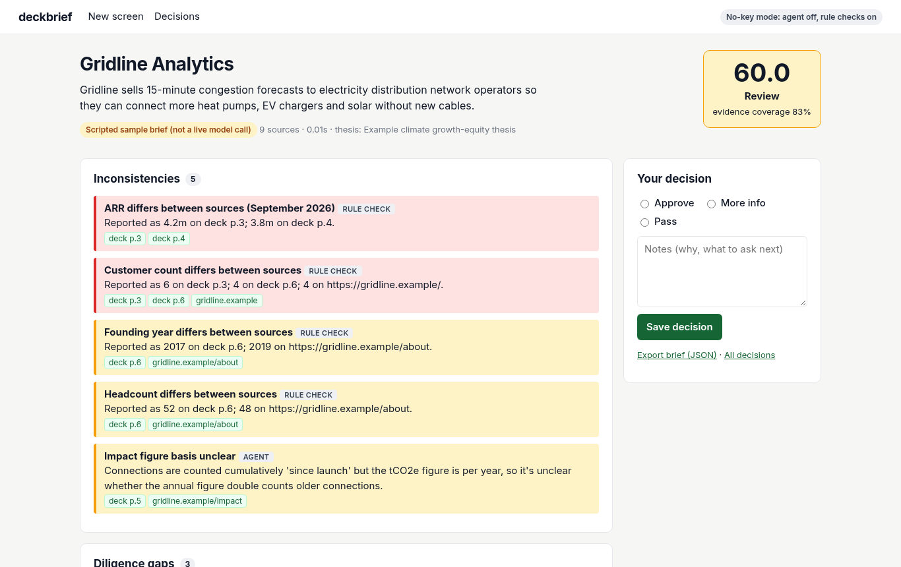
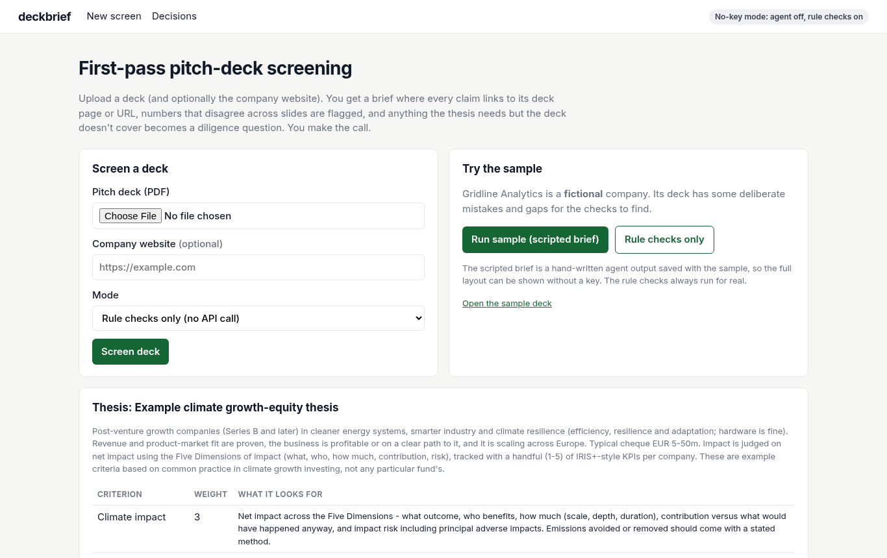
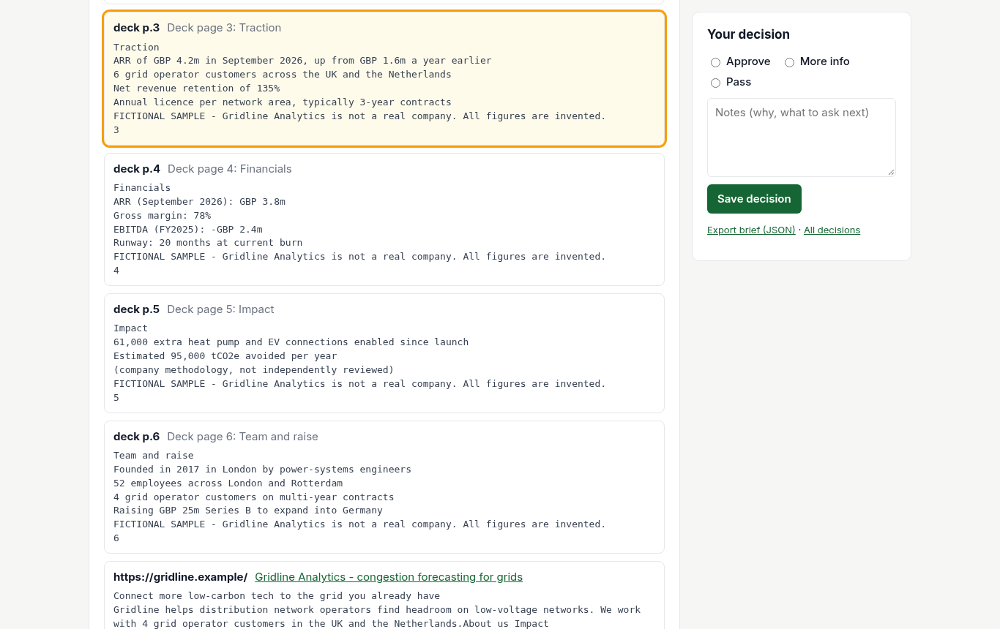
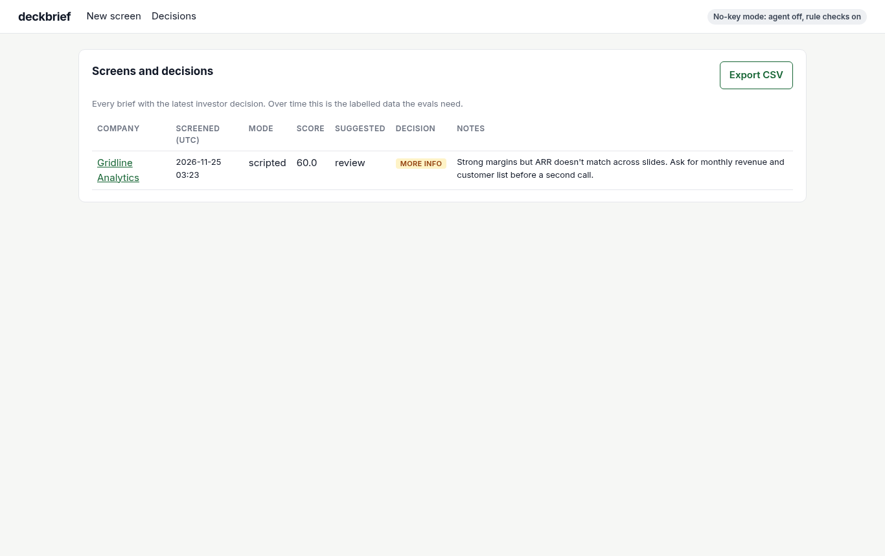
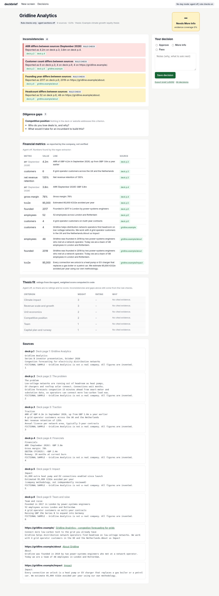

# deckbrief

First-pass screening for pitch decks. Give it a deck PDF (and optionally the company's website) and it produces a short investment brief against a fund's criteria: the company's reported metrics, competitive position, climate impact, a thesis-fit score, numbers that don't add up across slides, and the things the deck doesn't tell you, turned into diligence questions. Every claim links back to the deck page or web page it came from, and an investor records the actual decision.



*The bundled sample: Gridline Analytics is a made-up company whose deck has some deliberate mistakes in it.*

## Why I built it

I built this after writing a cover letter about automating first-pass deal screening. It's informed by how screening worked during an investment internship, where a lot of time went on reading decks, pulling out the numbers and checking them against the website before anyone decided whether a company was worth a call. That first read is fairly mechanical, and the bits that matter most (a number that changes between slides, or a section that's missing entirely) are easy to miss on the tenth deck of the day.

It's a sequel to [dealscreen](https://github.com/ahyanadatia/dealscreen), which screens companies from public registry and web data. This one starts from the deck instead.

## What it does

- **Reads the deck page by page.** Each page becomes a source cited as `deck p.N`. Website pages are fetched (homepage plus a few likely pages like About or Impact) and cited by URL.
- **Rule checks, no LLM involved.** Regexes pull out ARR, revenue, customer counts, headcount, founding year, gross margin, NRR and tCO2e figures, then compare them across pages and the website. ARR for September 2026 is only compared with other ARR figures for the same period, so growth isn't flagged as a conflict.
- **Diligence gaps.** Any thesis criterion with no evidence anywhere is listed as a gap with suggested questions from the thesis file.
- **The agent (optional).** With an Anthropic key, a Claude tool-use loop reads the deck and website, can fetch up to three more pages on the company's own domain, and has to finish by calling a `submit_brief` tool with a fixed schema: company-reported metrics, competitive position, climate impact (mechanism, rough abatement logic, the Five Dimensions of impact, candidate KPIs), a 0-5 rating per criterion, extra inconsistencies it noticed, and questions for a first call.
- **Scoring happens in code.** The model only rates individual criteria. Python computes the weighted score, the evidence coverage and the suggestion (advance / review / pass / needs more info). A rating that doesn't cite a real source doesn't count and becomes a gap instead.
- **Citations are checked.** Any source id the model cites that it was never given is removed. A metric left with no valid citation moves to "unverified".
- **Decisions are logged.** Approve, more info or pass, with notes, stored in SQLite. There's a history page and a CSV export, since past decisions are what you'd eventually evaluate against.
- **Eval skeleton.** `deckbrief eval` runs the pipeline over a few labelled cases and reports flag recall, decision agreement and time per screen.

## Running it

```bash
python -m venv .venv && source .venv/bin/activate
pip install -e ".[dev]"
cp .env.example .env        # add ANTHROPIC_API_KEY to turn the agent on
deckbrief serve             # http://127.0.0.1:8000
```

Without a key it runs in no-key mode: deck extraction, website fetching, the rule checks, gap detection and the decision log all work, the header says the agent is off, and the agent sections are left out. The sample also has a scripted brief (a hand-written agent output saved in the repo, clearly labelled as such) so you can see the full layout without making any API calls.

CLI:

```bash
deckbrief sample                    # fictional sample, scripted brief
deckbrief sample --offline          # rule checks only
deckbrief sample --live             # real agent run (needs a key)
deckbrief screen deck.pdf --website https://example.com [--live] [--json brief.json]
deckbrief decide <brief-id> more_info --notes "ask for monthly revenue"
deckbrief history [--csv]
deckbrief eval [--live]
```

Docker: `docker build -t deckbrief . && docker run -p 8000:8000 -e ANTHROPIC_API_KEY=... deckbrief`

The model defaults to `claude-sonnet-5-5` and can be changed with `DECKBRIEF_MODEL`.

## The thesis file

Criteria live in [`src/deckbrief/theses/climate_growth.yaml`](src/deckbrief/theses/climate_growth.yaml): an example climate growth-equity thesis (Series B+, proven revenue, EUR 5-50m cheques, impact judged on the Five Dimensions with a few IRIS+-style KPIs). Each criterion has a weight, guidance for the model, keywords used by the gap check, and the questions to ask when it's missing. It isn't any particular fund's criteria. To screen against something else, copy the file and pass `--thesis`.

## How it fits together

```
deck.pdf ──> deck.py (one source per page) ──┐
website  ──> web_sources.py (safe fetch) ────┤
                                             v
                            checks.py: figures, inconsistencies, gaps     (always)
                                             v
                            agent.py: Claude tool use -> submit_brief     (with a key)
                                             v
                            clean citations -> scoring.py -> Brief -> store.py (SQLite)
                                             v
                                   web UI / CLI, investor decision
```

## Screenshots

| | |
|---|---|
|  |  |
|  |  |

## Limits

- **The sample data is fictional, and so is the eval set.** The three companies were written for this repo, so 100% flag recall on them only shows the harness works. Real use would need labelled past screens.
- The regexes are simple. They handle "ARR of GBP 4.2m in September 2026" but will miss figures in charts, tables that extract badly, or unusual wording. Scanned or image-only decks aren't supported (no OCR).
- Counts like customers and headcount are compared regardless of date, so a deck that mixes old and new figures can produce false positives. That's deliberate: I'd rather ask the question than miss it.
- Everything in a deck is company-reported. The brief labels it that way, but it doesn't verify anything against filings or third-party data.
- The impact section is a first pass. An "evidenced" label only means the deck cited a method, not that the method is any good.
- Decision agreement in the eval needs agent ratings, so it only runs with `--live`.
- The keyed path is tested with a fake Anthropic client in the test suite. Run `deckbrief sample --live` once with your own key to see a real model output.

## Development

```bash
pytest
ruff check . && ruff format --check .
mypy src
python scripts/make_sample_decks.py   # regenerate the sample decks
```

MIT licence.
